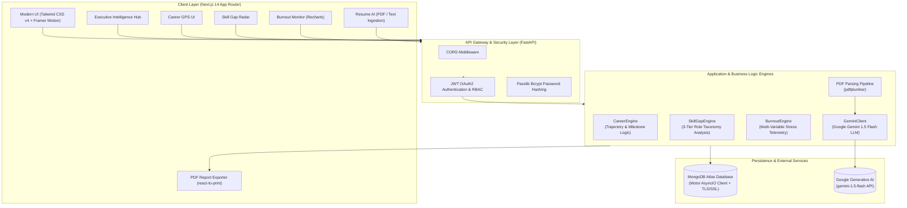

# 🚀 LifeOS AI — Autonomous Career Copilot & Cognitive Wellness System

<div align="center">

[](https://fastapi.tiangolo.com)
[](https://nextjs.org/)
[](https://www.python.org/)
[](https://www.typescriptlang.org/)
[](https://ai.google.dev/)
[](https://www.mongodb.com/atlas)
[](https://tailwindcss.com/)
[](LICENSE)

<br/>

**LifeOS AI** is an enterprise-grade, full-stack career acceleration and cognitive health platform. It empowers software professionals and engineering candidates to systematically analyze competency gaps, synthesize adaptive learning roadmaps via LLM intelligence, evaluate resume-to-market alignment, and monitor work-life fatigue with predictive burnout telemetry.

[Key Features](#-key-features) • [System Architecture](#-system-architecture) • [Engineering Highlights](#-engineering-highlights) • [Tech Stack](#-technology-stack) • [API Documentation](#-api-documentation) • [Quick Start](#-quick-start-guide) • [Author](#-author)

</div>

---

## 💡 Executive Summary & Problem Statement

Modern software engineers, data scientists, and ML specialists navigate an intensely fragmented career landscape:
1. **Ambiguous Skill Requirements**: Industry job requirements evolve rapidly across AI, MLOps, and Cloud ecosystems without standardized readiness benchmarks.
2. **Generic Career Guidance**: Traditional career platforms output static, cookie-cutter advice instead of tailored, chronological engineering roadmaps.
3. **Unmitigated Developer Burnout**: High-output engineers face unmonitored cognitive strain, overwork fatigue, and suboptimal rest cycles that degrade long-term productivity.

**LifeOS AI** bridges this chasm by delivering an **autonomous career operating system**. By uniting deterministic domain taxonomy algorithms with **Google Gemini 1.5 Flash** generative reasoning, LifeOS AI benchmarks candidates against real-world role requirements, analyzes uploaded resumes, formulates concrete project blueprints, and continuously monitors cognitive workload via multi-factor burnout algorithms.

---

## 🌟 Key Features

### 🧭 1. Career GPS Engine
- **Dynamic Trajectory Computation**: Synthesizes individualized, step-by-step career roadmaps based on user input skills, interest vectors, experience tier, and target designation.
- **Milestone Timeline Estimation**: Calculates realistic completion timelines (ranging from 3 to 12+ months) based on target difficulty and skill deficits.
- **Capstone Project Synthesis**: Recommends production-grade portfolio projects (e.g., *RAG Chatbots with LangChain & Pinecone*, *Automated MLOps Pipelines with Kubernetes*) designed to demonstrate production readiness to hiring managers.

### 🧠 2. Skill Gap Predictor & Readiness Radar
- **3-Tier Competency Taxonomy**: Evaluates competencies across three critical industry dimensions:
  - **Core Fundamentals**: Languages, frameworks, algorithmic foundations.
  - **Advanced Specialization**: Deep learning, distributed systems, vector retrieval, orchestration.
  - **Deployment & Production**: Docker, Kubernetes, CI/CD, cloud architecture (AWS/GCP), monitoring.
- **Curved Job Readiness Score**: Algorithmic scoring formula that normalizes readiness percentages based on seniority tier (Beginner, Intermediate, Advanced).
- **Target Role Knowledge Base**: Pre-calibrated skill benchmarks for **AI/ML Engineers**, **Data Scientists**, **MLOps Engineers**, **Full Stack Developers**, and **Product AI Engineers**.
- **Historical Audit Trail**: Tracks and records past gap analyses to visualize progress over time.

### ❤️ 3. Burnout Monitor & Work-Life Telemetry
- **Multi-Factor Clinical Scoring Model**:
  $$\text{Burnout Score} = \text{Stress (max 50)} + \text{Mood Inversion (max 30)} + \text{Sleep Quality (max 20)} + \text{Workload Penalty}$$
  - **Stress**: 1–10 scale weighted $\times 5$.
  - **Mood**: 1–5 inverted scale weighted $(6 - \text{mood}) \times 6$.
  - **Sleep Quality**: Categorical penalty (Good = 0, Average = +10, Poor = +20).
  - **Workload Fatigue**: Overtime threshold penalties (+10 if $>10$ hrs, +20 if $>12$ hrs).
- **Risk Classification**: Instant categorization into **Low** ($<40$), **Medium** ($40-74$), or **High** ($\ge 75$) burnout danger tiers.
- **7-Day Historical Analytics**: Interactive temporal time-series charts rendered via **Recharts** to identify exhaustion trends before burnout occurs.
- **Targeted Action Engine**: Automatically prescribes immediate, contextual clinical interventions (e.g., immediate work pauses, sleep hygiene alerts, mentorship checkpoints).

### 📄 4. Resume Intelligence (LLM-Powered via Gemini 1.5 Flash)
- **Automated Document Ingestion**: Dual-mode input supporting high-fidelity PDF extraction via `pdfplumber` alongside raw text ingestion.
- **Structured LLM Prompt Engineering**: Evaluates candidate resumes against target roles using **Google Gemini 1.5 Flash** with strict JSON Schema constraints.
- **Comprehensive Career Diagnostics**:
  - Executive career standing summary.
  - Extracted missing and weak domain competencies.
  - Multi-phase sprint roadmap (Months 1–2, Months 3–4, Months 5–6) with concrete technical objectives.
  - Tailored project ideas with full tech stack breakdowns.
  - Calibrated Job Readiness Index (0–100).
- **Resilient Fallback & Sanitization Pipeline**: Cleans Markdown backtick fences and handles JSON decoding edge cases gracefully with persistent error telemetry.

### 📊 5. Unified Executive Intelligence Hub
- **Executive Command Center**: Aggregates career readiness, skill audit deltas, and mental wellness metrics into a unified dashboard view.
- **Dynamic Daily Recommendations**: Context-aware insight engine prioritizing top actions (e.g., highest ROI skill to learn today, risk alerts, module next steps).

### 🖨️ 6. Automated PDF Report Generation
- **One-Click Audit Export**: Integrated browser printing and PDF generation via `react-to-print` across Career GPS, Skill Gap, and Burnout modules.
- **Interview & Mentor Ready**: Generates polished, clean reports suitable for mentor reviews, career counseling sessions, or portfolio attachments.

---

## 🏗️ System Architecture



---

## 🛠️ Technology Stack

| Layer | Technology | Version | Purpose |
|---|---|---|---|
| **Frontend Framework** | Next.js (App Router) | 14.2+ | Server-side rendering, modern client components, dynamic routing |
| **Language (UI)** | TypeScript | 5.4+ | Type-safe front-end architecture, strict interfaces & models |
| **Styling & Design** | Tailwind CSS | v4.0 | Modern CSS-variable tokens, glassmorphism, responsive styling |
| **Animation Engine** | Framer Motion | 11.0+ | Micro-interactions, animated card transitions, state morphing |
| **Data Visualization** | Recharts | 2.12+ | Interactive 7-day burnout line charts and trend telemetry |
| **Document Export** | react-to-print | 3.0+ | Native browser-to-PDF high-resolution document generation |
| **Icons & Assets** | Lucide React | 0.354+ | Unified, accessible SVG iconography |
| **Backend Framework** | FastAPI | 0.110+ | High-performance asynchronous REST API framework |
| **Language (API)** | Python | 3.11+ | Backend execution runtime |
| **Database** | MongoDB Atlas | 7.0+ | Cloud NoSQL document store for users, roadmaps, logs, audits |
| **DB Driver (Async)** | Motor / AsyncIO | 3.3+ | Non-blocking, asynchronous MongoDB operations |
| **Authentication** | PyJWT & OAuth2 | 3.3+ | Cryptographic Bearer token creation and stateless validation |
| **Password Security** | Passlib (Bcrypt) | 1.7+ | Industry-standard salted password hashing |
| **LLM Provider** | Google Gemini API | 1.5 Flash | Structured JSON schema generation, resume audit & career reasoning |
| **Document Processing**| pdfplumber | 0.11+ | Precise PDF text, layout, and table extraction |
| **Data Validation** | Pydantic v2 | 2.6+ | Strict data serialization, request/response validation |

---

## ⚡ Engineering Highlights & Design Decisions

### 1. Hybrid Intelligence: Deterministic Heuristics + Generative LLM
Rather than relying purely on LLMs (which can hallucinate or introduce non-deterministic latency) or purely on static rules, LifeOS AI adopts a **hybrid multi-layer architecture**:
- **Deterministic Layer** (`SkillGapEngine`, `CareerEngine`, `BurnoutEngine`): Sub-millisecond response time for standard benchmarks, role taxonomies (Core, Advanced, Deployment), and clinical burnout arithmetic.
- **Generative AI Layer** (`GeminiClient` with `gemini-1.5-flash`): Executes unstructured document analysis, contextual resume critique, creative capstone project formulation, and individualized sprint breakdowns.

### 2. Strict Structured Output Enforcement & Markdown Cleansing
LLMs often wrap JSON outputs with conversational prose or markdown formatting (` ```json ... ``` `). LifeOS AI enforces:
- `response_mime_type="application/json"` in Gemini generation configuration.
- Automated token and string sanitizers stripping code fences before schema validation.
- Pydantic models ensuring guaranteed data contracts between Python backend and Next.js frontend.

### 3. Non-Blocking Asynchronous Core
Built with Python's `asyncio` and `Motor`, every database read/write and AI network call runs without blocking the server loop. This guarantees high throughput and low tail latency even under concurrent resume ingestion workloads.

### 4. Zero-Trust Stateless Security
- Salted bcrypt password hashing (`passlib[bcrypt]`).
- Signed JWT access tokens with configurable expiration (`HS256`).
- Automatic session invalidation and HTTP 401 interceptors on the Next.js client.
- TLS/SSL verification via `certifi` ensuring encrypted database handshakes on cloud clusters.

---

## 📡 API Documentation

All API endpoints are prefixed with `/api/v1` and document interactive Swagger UI specs at `/api/v1/docs`.

### Authentication & Users
| Method | Endpoint | Auth | Description |
|---|---|---|---|
| `POST` | `/api/v1/auth/signup` | Public | Registers a new user with bcrypt-hashed credentials |
| `POST` | `/api/v1/auth/login` | Public | Authenticates user; returns OAuth2 Bearer access token |
| `GET` | `/api/v1/users/me` | Bearer | Fetches profile and metadata of authenticated user |

### Career GPS & Skill Gap
| Method | Endpoint | Auth | Description |
|---|---|---|---|
| `POST` | `/api/v1/career/recommend` | Bearer | Computes personalized milestones, gaps, and capstone ideas |
| `POST` | `/api/v1/skill-gap/analyze` | Bearer | Evaluates skills against 3-tier role taxonomies; returns match score |
| `GET` | `/api/v1/skill-gap/history` | Bearer | Retrieves user's historical skill gap audits (last 5 runs) |

### Burnout & Wellness Telemetry
| Method | Endpoint | Auth | Description |
|---|---|---|---|
| `POST` | `/api/v1/burnout/checkin` | Bearer | Logs stress, mood, sleep, hours; calculates burnout index and actions |
| `GET` | `/api/v1/burnout/history` | Bearer | Retrieves historical burnout entries for trend analysis |

### Resume Intelligence & LLM Roadmap
| Method | Endpoint | Auth | Description |
|---|---|---|---|
| `POST` | `/api/v1/resume/analyze` | Bearer | Ingests PDF/text resume; extracts clean plain text via `pdfplumber` |
| `POST` | `/api/v1/ai/roadmap` | Bearer | Invokes Gemini 1.5 Flash to synthesize deep career roadmap & projects |

### Executive Dashboard
| Method | Endpoint | Auth | Description |
|---|---|---|---|
| `GET` | `/api/v1/dashboard/summary` | Bearer | Aggregated metrics, widget summaries, and system status |
| `GET` | `/api/v1/dashboard/insights` | Bearer | Personalized daily recommendation feed |

---

## 📁 Repository Structure

```text
LifeOS_AI/
│
├── api/                           # FastAPI Python Backend
│   ├── app/
│   │   ├── api/
│   │   │   ├── endpoints/
│   │   │   │   ├── ai.py          # Gemini LLM roadmap synthesis endpoint
│   │   │   │   ├── auth.py        # Authentication & JWT issuance
│   │   │   │   ├── burnout.py     # Burnout algorithm & telemetry check-ins
│   │   │   │   ├── career.py      # Career GPS trajectory endpoints
│   │   │   │   ├── dashboard.py   # Unified summary & daily insights feed
│   │   │   │   ├── resume.py      # PDF parsing & text extraction
│   │   │   │   ├── skill_gap.py   # Skill gap analysis & history endpoints
│   │   │   │   └── users.py       # Current user profile management
│   │   │   ├── api.py             # Master APIRouter registry
│   │   │   └── dependencies.py    # OAuth2 dependencies & DB injectors
│   │   ├── core/
│   │   │   ├── config.py          # Pydantic BaseSettings & CORS policies
│   │   │   └── security.py        # Bcrypt hashing & JWT token generators
│   │   ├── db/
│   │   │   └── mongo.py           # Motor AsyncIO MongoDB connection client
│   │   ├── schemas/               # Pydantic v2 data contract schemas
│   │   │   ├── burnout.py
│   │   │   ├── career.py
│   │   │   ├── resume.py
│   │   │   ├── skill_gap.py
│   │   │   └── user.py
│   │   └── services/              # Core business & analysis engines
│   │       ├── career_engine.py   # Deterministic career milestone generator
│   │       ├── gemini_client.py   # Google Gemini 1.5 Flash client
│   │       └── skill_engine.py    # 3-tier role taxonomy & readiness scorer
│   ├── main.py                    # FastAPI application initialization & ASGI entry
│   └── requirements.txt           # Python backend dependencies
│
├── web/                           # Next.js 14 Frontend Application
│   ├── src/
│   │   ├── app/
│   │   │   ├── dashboard/
│   │   │   │   ├── burnout/       # Daily wellness check-in & Recharts trend UI
│   │   │   │   ├── career-gps/    # Trajectory form & milestone roadmap UI
│   │   │   │   ├── insights/      # Contextual recommendations feed
│   │   │   │   ├── profile/       # User account details
│   │   │   │   ├── resume-ai/     # Resume upload, Gemini analysis & sprint UI
│   │   │   │   ├── skill-gap/     # Role benchmarking & history audit UI
│   │   │   │   └── page.tsx       # Main executive dashboard
│   │   │   ├── login/             # User sign-in page
│   │   │   ├── signup/            # User onboarding & registration page
│   │   │   ├── globals.css        # Tailwind CSS v4 design tokens & themes
│   │   │   ├── layout.tsx         # Root layout with navigation & footer
│   │   │   └── page.tsx           # High-impact landing page with shader hero
│   │   ├── components/
│   │   │   ├── ui/                # Reusable UI component library (Shadcn-style)
│   │   │   │   ├── animated-shader-hero.tsx
│   │   │   │   ├── badge.tsx
│   │   │   │   ├── button.tsx
│   │   │   │   ├── card.tsx
│   │   │   │   ├── input.tsx
│   │   │   │   ├── pdf-button.tsx # react-to-print PDF generator button
│   │   │   │   ├── progress.tsx
│   │   │   │   ├── select.tsx
│   │   │   │   ├── slider.tsx
│   │   │   │   └── textarea.tsx
│   │   │   ├── Footer.tsx         # Global footer
│   │   │   └── Navbar.tsx         # Global responsive navigation with auth state
│   │   └── lib/
│   │       └── utils.ts           # Classnames merging (clsx + tailwind-merge)
│   └── package.json               # Node.js dependencies & build scripts
│
├── .gitignore
└── README.md                      # Project documentation
```

---

## 🚀 Quick Start Guide

### Prerequisites
- **Python**: `3.11+`
- **Node.js**: `18.17+` (or `20+`)
- **MongoDB Atlas**: Free cluster connection URI
- **Google Gemini API Key**: Obtainable from [Google AI Studio](https://aistudio.google.com/)

---

### Step 1: Clone the Repository
```bash
git clone https://github.com/RakeshBabuGajula/LifeOS_AI.git
cd LifeOS_AI
```

---

### Step 2: Backend Configuration & Startup

1. **Navigate to the API directory:**
   ```bash
   cd api
   ```

2. **Create and activate a virtual environment:**
   ```bash
   # Windows (PowerShell)
   python -m venv venv
   .\venv\Scripts\Activate.ps1

   # Linux / macOS
   python3 -m venv venv
   source venv/bin/activate
   ```

3. **Install dependencies:**
   ```bash
   pip install -r requirements.txt
   ```

4. **Configure Environment Variables:**
   Create a `.env` file inside `api/`:
   ```env
   PROJECT_NAME="LifeOS AI"
   SECRET_KEY="replace_with_a_secure_random_secret_key"
   ALGORITHM="HS256"
   ACCESS_TOKEN_EXPIRE_MINUTES=60
   MONGODB_URI="your_mongodb_atlas_connection_string"
   GEMINI_API_KEY="your_google_gemini_api_key"
   GEMINI_MODEL="gemini-1.5-flash"
   ```

5. **Start the FastAPI ASGI server:**
   ```bash
   uvicorn main:app --reload --port 8000
   ```
   *The backend will be live at `http://localhost:8000`. Access interactive API documentation at `http://localhost:8000/api/v1/docs`.*

---

### Step 3: Frontend Configuration & Startup

1. **Open a new terminal and navigate to the web directory:**
   ```bash
   cd web
   ```

2. **Install dependencies:**
   ```bash
   npm install
   ```

3. **Configure Environment Variables:**
   Create a `.env.local` file inside `web/`:
   ```env
   NEXT_PUBLIC_API_URL="http://localhost:8000/api/v1"
   ```

4. **Launch the Next.js development server:**
   ```bash
   npm run dev
   ```
   *The application will be live at `http://localhost:3000`.*

---

## 🔮 Scalability & Future Roadmap

- [ ] **Vector Search & RAG**: Implement embeddings with **Pinecone / Milvus** to semantically index 100k+ live engineering job descriptions and match resumes with cosine similarity.
- [ ] **Automated ATS Score Simulator**: Detailed keyword density, section parsing, and ATS compatibility heatmaps.
- [ ] **Predictive ML for Burnout**: Train a time-series forecasting model (e.g., Prophet or LSTM) on historical check-in logs to predict burnout risk 14 days in advance.
- [ ] **Enterprise Team Analytics**: Role-based access for engineering directors to monitor team sentiment, balance sprint loads, and optimize skill upskilling.
- [ ] **OAuth2 Social Sign-In**: Native one-click authentication with GitHub, Google, and LinkedIn.

---

## 👨‍💻 Author

**Rakesh Babu Gajula**  
*Full Stack & AI Engineer*

- **GitHub**: [@RakeshBabuGajula](https://github.com/RakeshBabuGajula)
- **LinkedIn**: [Rakesh Babu Gajula](https://www.linkedin.com/in/rakesh-babu-gajula)
- **Portfolio**: [rakeshbabu.dev](https://github.com/RakeshBabuGajula/my_portfolio)
- **Email**: [grakesh2605@gmail.com](mailto:grakesh2605@gmail.com)

---

## 📄 License

This project is licensed under the **MIT License** — feel free to use and adapt it for your own career or educational endeavors.
